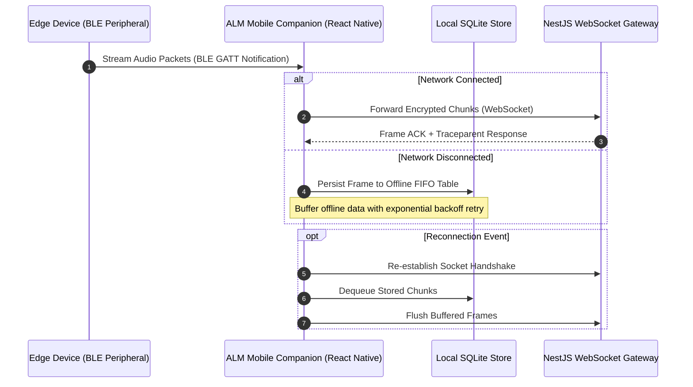

# ALM Mobile Edge Client — Real-Time Audio Relay & Device Companion

[](https://reactnative.dev/)
[](https://expo.dev/)
[](https://www.typescriptlang.org/)
[](https://docs.expo.dev/versions/latest/sdk/sqlite/)

A resilient React Native edge client built with Expo bare workflow. Responsible for pairing with BLE edge audio hardware, managing local packet queuing via SQLite during cellular network drops, and streaming low-latency Opus audio packets over secure WebSockets to the distributed ingestion gateway.

---

## 🚀 Key Architectural Features

- **BLE Device Ingestion (`react-native-ble-plx`)**: Low-energy GATT client handling peripheral discovery, MTU negotiation (up to 512 bytes), and streaming chunk assembly.
- **Offline Resilient Packet Queue (`expo-sqlite`)**: Persistent FIFO buffer holding encrypted audio frames locally when cellular or Wi-Fi connectivity drops, automatically flushing upon reconnect.
- **Bi-directional WebSocket Gateway**: Real-time chunk streaming with sub-100ms packet delivery, session heartbeat, and automatic JWT rotation.
- **Hardware Cryptographic Identity (`expo-secure-store`)**: Secure on-device key management ensuring every streamed payload is cryptographically authenticated.

---

## 🏛️ Edge Ingestion Architecture



---

## 🛠️ Setup & Development

### 1. Prerequisites
- **Node.js 18+**
- **Android SDK & NDK** (for Android build) or Xcode (for iOS build)
- **Running NestJS Backend**

### 2. Configuration
Copy the sample environment file:
```bash
cp .env.example .env
```
Update URLs to point to your local backend or tunnel:
```env
EXPO_PUBLIC_WS_URL=ws://localhost:3000
EXPO_PUBLIC_API_BASE_URL=http://localhost:3000/v1
```

### 3. Installation
```bash
npm install
npx expo prebuild
```

### 4. Running
```bash
# Launch on Android emulator or connected device
npx expo run:android

# Launch on iOS simulator
npx expo run:ios
```

### 5. Running Tests & Typechecks
```bash
npm test
npm run typecheck
npm run lint
```
